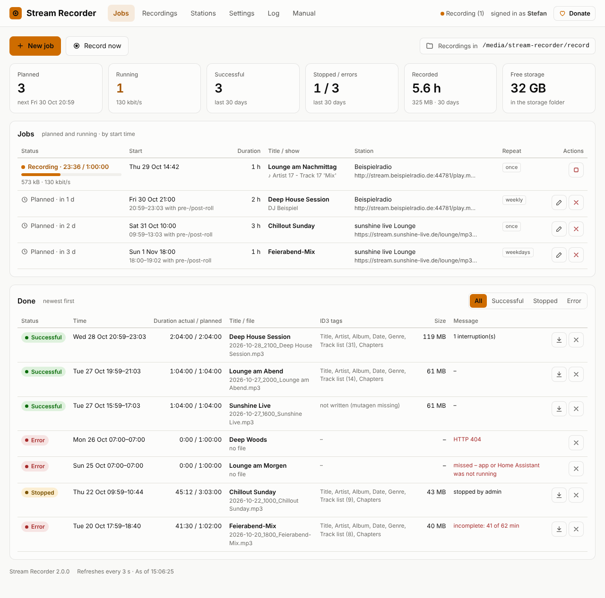
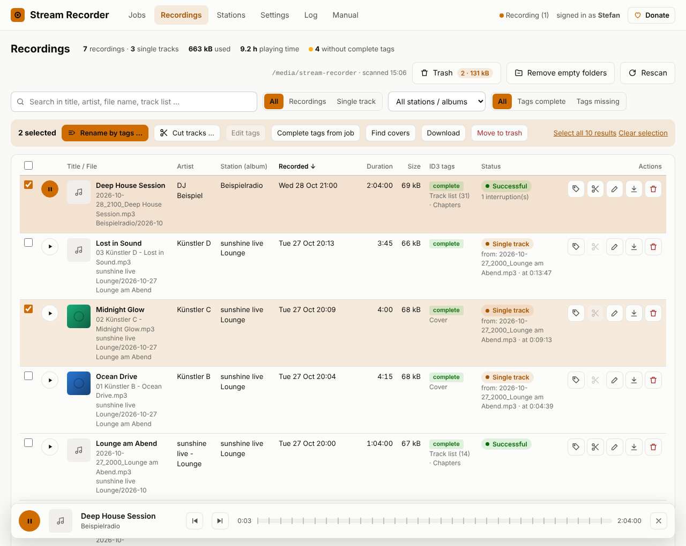
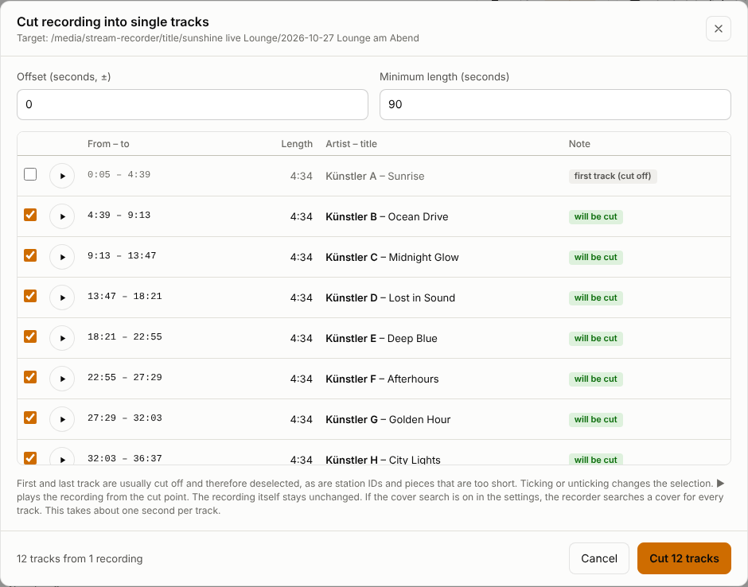

# Stream Recorder for Home Assistant

A Home Assistant app that **records MP3 web radio streams on a schedule** – with the
track list and chapters taken from the stream titles, ID3 tags, a recordings browser,
**lossless cutting into single tracks** with covers, a trash folder and sensors for your
automations.



## Features

**Recording**
- Jobs with start time, duration, pre-/post-roll and repeat (once, daily, weekdays, weekly),
  or **Record now**. Several streams can be recorded at the same time.
- Stores the stream exactly as it arrives – no re-encoding, no quality loss, no ffmpeg.
- Resolves playlists (`.m3u`, `.pls`) and redirects, reconnects automatically when the
  stream drops and keeps writing into the same file.
- ICY stream titles become a **track list** (ID3 comment) and **chapters** – podcast apps
  jump straight to a song.
- ID3 tags: title, artist/presenter, album = station, date, genre.
- Stations with a **stream test** (format, bit rate, title info, final URL).

**Recordings**
- All files in `record/` and `title/`: search (also inside the track lists), filter,
  sort, 10/25/50/100/all per page, playback in the browser with chapter marks.
- Edit tags and covers, **rename by tags** with preview and undo, complete tags from the job.
- **Cut into single tracks** at the track changes – first/last track, station IDs and
  too-short pieces are deselected, adjustable offset and minimum length. Each track gets
  its own tags and a **cover from Deezer or Apple iTunes** (strict matching: better none
  than a wrong one).
- **Trash** in `deleted/` with restore, delete permanently, empty, and optional automatic
  emptying after a number of days. Folders that became empty are removed.



**Home Assistant**
- Opens in the **sidebar** (ingress, no extra login). Optional direct access on your own
  port with username and password.
- Recordings live in `/media/stream-recorder` – visible in the media browser, works with a
  NAS added as network storage.
- Entities: `binary_sensor.stream_recorder_recording`, `sensor.stream_recorder_next_recording`,
  `sensor.stream_recorder_last_recording`, `sensor.stream_recorder_planned`,
  `sensor.stream_recorder_disk_free`.
- Events `stream_recorder_finished` and `stream_recorder_error`.
- Start and stop recordings from automations with `hassio.app_stdin`.
- German and English, following the Home Assistant language. Built-in user manual in both
  languages.
- Logs only into its own log (log page in the app), nothing into the Home Assistant log.



## Installation

1. *Settings › Apps › App Store* → ⋮ → *Repositories* → add
   `https://github.com/BreitiDE/ha-stream-recorder`.
2. Install **Stream Recorder**, optionally adjust the configuration, start it and turn on
   *Show in sidebar*.
3. Open **Stream Recorder** in the sidebar, add a station and plan a job.

Requires Home Assistant OS or a Supervised installation (amd64 or aarch64).

## Configuration

| Option | Default | Meaning |
|---|---|---|
| `storage_path` | `/media/stream-recorder` | below `/media` or `/share`; contains `record/`, `title/`, `deleted/` |
| `username`, `password` | empty | direct access without Home Assistant; both empty = off |
| `log_level` | `info` | `debug`, `info`, `warning`, `error` |
| Network port `8765/tcp` | off | port for direct access |

Everything else (file name patterns, pre-/post-roll, cutting, covers, trash, language) is
set in the app under **Settings**.

## Automations

```yaml
# Notify on a failed recording
triggers:
  - trigger: event
    event_type: stream_recorder_error
actions:
  - action: notify.notify
    data:
      title: "Recording failed"
      message: "{{ trigger.event.data.title }}: {{ trigger.event.data.message }}"
```

```yaml
# Record now from an automation or script (duration in minutes)
action: hassio.app_stdin
data:
  app: f91e2bd5_stream_recorder      # see the address bar of the app page
  input:
    action: record
    sender: sunshine live Lounge     # station name as in the app, or url: https://…
    duration: 60
    title: Recording by automation
```

Stop with `input: {action: stop}` (all) or `{action: stop, title: …}`.

## Kurz auf Deutsch

Home-Assistant-App, die MP3-Webradio-Streams zeitgesteuert aufnimmt: Titelliste und
Kapitel aus den Stream-Titeln, ID3-Tags, Seite „Aufnahmen“ mit Abspielen, Tags,
Umbenennen, verlustfreiem Schneiden in Einzeltitel mit Cover-Suche, Papierkorb unter
`/media/stream-recorder/deleted`, Sensoren und Ereignisse für Automationen. Oberfläche und
Anleitung auf Deutsch und Englisch, Bedienung über die Seitenleiste.
Installation wie oben beschrieben, die ausführliche Anleitung steht in der App unter
**Anleitung**.

## Support

☕ Like the app? / Gefällt Dir die App? [Donate via PayPal / Spenden](https://paypal.me/breitide) – thank you!

## License

MIT
